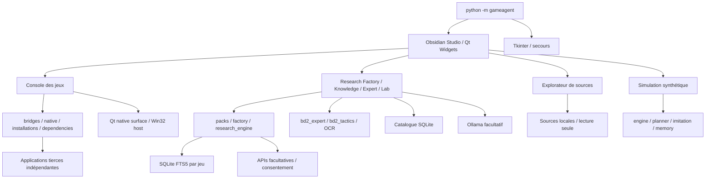

# Architecture — v0.15.0

La bibliothèque lance les workbenches dans des processus Python distincts. Les workbenches partagent leurs composants visuels mais conservent leurs propres états et traitements. Les modules métier restent indépendants de Qt. Les configurations de profil sont isolées ; le code amont n'est pas intégré au moteur de décision.

L'hébergement Win32 est un adaptateur de fenêtre, pas une API de tâches. Les modules IA n'envoient pas de commandes au client réel. La recherche distante produit des candidats, soumis à vérification et import explicites. Le simulateur est une expérience synthétique indépendante.

Voir [référence technique](technical-reference.md) pour les contrats et limites.
