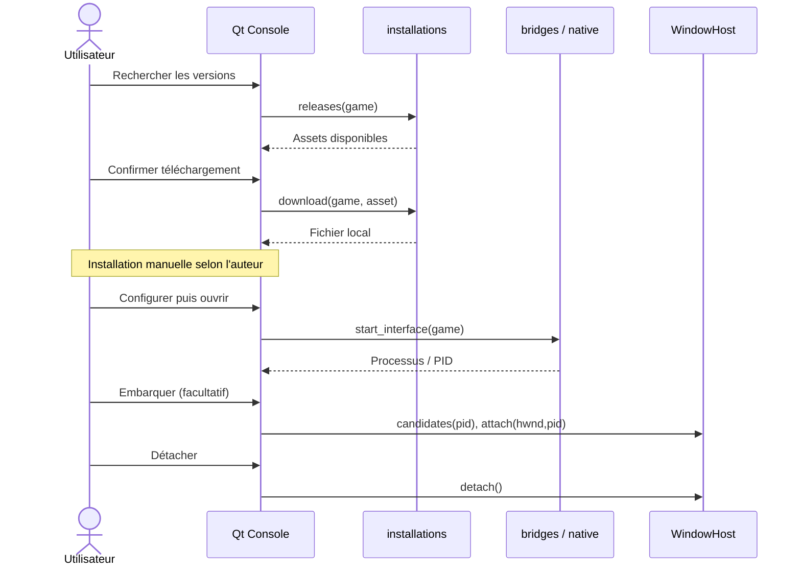

# Documentation technique — GameAgent AI v0.15.0

**Révision de référence :** 815f6a30197e613507630dfc8e05b612668b0e4d. Cette documentation décrit le code livré, pas une promesse de capacités futures.

## 1. Organisation

```text
GameAgent-AI/
  gameagent/          Modules Python, Qt et Tkinter
  games/<id>/         Manifestes, sources et recettes par jeu
  knowledge_packs/    Registre et fiches initiales JSON
  assets/games/       Illustrations locales facultatives
  data/               État local, ignoré par Git
  docs/               Guides et références
  tests/              Tests unittest
  .github/workflows/  CI Windows / Ubuntu
```

Identifiants : nikke, brown_dust_2, genshin_impact, wuthering_waves, neverness_to_everness, honkai_star_rail. Chaque jeu possède manifest.json, project.json, upstream.json, recognition.json et knowledge_sources.json. Les trois fichiers BD2 supplémentaires (expert_seed, characters_seed, example_team) sont spécifiques à ce profil.

## 2. Couche graphique et cycle de vie

| Module | Responsabilité |
|---|---|
| __main__.py | Sélection Qt si PySide6 importable ; --classic force Tkinter |
| obsidian_ui.py | Studio, bibliothèque, profils et lancement de modules |
| obsidian_art.py | Images procédurales Pillow déterministes, cache LRU et surcharge locale |
| qt_workbench.py | Fenêtre partagée, sélection de profil, splitter, résultats, dialogues, jobs |
| qt_console.py | Console avec quatre onglets |
| qt_native_host.py | Adaptation QWidget natif à WindowHost |
| qt_research.py | 19 actions de la Research Factory |
| qt_knowledge.py | Recherche guides/catalogue/Ollama |
| qt_expert.py | Formulaire Account et conseiller BD2 |
| qt_lab.py | Catalogue, tactique, OCR, vidéo, RSS, logs |
| qt_sources.py | Inventaire local et aperçu texte |
| qt_simulation.py | Combat synthétique, timer, métriques, démonstrations |

Stack : Python 3.12+, PySide6 6.8–6.x (Qt Widgets, pas QML), Pillow. Thème QSS noir/vert citron et Segoe UI. Figma utilise Inter ; l'interface n'est pas pixel-perfect. Les modules historiques Tkinter restent accessibles.

Studio utilise subprocess.Popen avec sys.executable et un nom de module explicite. Workbench utilise ThreadPoolExecutor(max_workers=1), QTimer de 100 ms pour collecter les résultats et afficher les erreurs sur le thread UI. Les commandes et le choix du jeu sont désactivés pendant un job. Aucun job réseau récurrent n'est planifié. Les simulations utilisent un QTimer de 250 ms, plafonné à 30 tours. Les bases SQLite créées dans les workers sont fermées dans le même thread.

Le launcher Qt reste une collection de fenêtres distinctes, pas un monolithe à navigation unique. La fermeture d'une fenêtre avec job actif est refusée. La cohérence multi-processus des écritures de configuration n'est pas garantie par un verrou interprocessus.

## 3. Intégration amont



| Profil | Recette de bridge |
|---|---|
| nikke | gui.py, localhost 12271 |
| honkai_star_rail | gui.py, localhost 22367 |
| wuthering_waves | main.py, Python >=3.11 selon recette |
| neverness_to_everness | main.py, Python 3.12 selon recette |
| brown_dust_2 | Exécutable Windows installé |
| genshin_impact | Exécutable Windows installé |

Un exécutable enregistré est prioritaire. Sinon, le bridge exige l'entrée source et data/environments/ID/Scripts/python.exe. Les recettes sont des indications, pas des installateurs complets. Pour .NET, dependencies.py utilise winget pour Microsoft.DotNet.DesktopRuntime.10 et Microsoft.VCRedist.2015+.x64. Pour les sources Python, il exige un requirements.txt racine et un environnement uv isolé. Vérifier les dépendances avant installation.

Interfaces internes :
- native.load(game), native.save(game, executable, web_url), native.launch(game) : validation du profil, extension .exe et existence, URL HTTP loopback avec port.
- bridges.describe(game) et start_interface(game) : état et création du processus.
- installations.releases(game), download(game, asset) : sélection d'assets, contrôle de taille et digest publié si fourni ; pas d'exécution.
- project_hub.inspect(game), read_source(game,path), open_folder(game) : inventaire Git et aperçu texte borné, confinement du chemin au dossier du profil.
- task_catalog.inventory(game) : lecture seule ; MFABD2 dispose d'un inventaire des tâches déclarées, les autres profils de composants. Ce n'est pas une API de tâche.

WindowHost utilise EnumWindows, vérifie le PID et la visibilité, sauvegarde parent/style/rectangle, applique SetParent et redimensionne la fenêtre. NativeSurface fournit un HWND Qt et les dimensions mises à l'échelle DPI. detach restaure le parent/style et la géométrie. Les fenêtres d'un processus enfant ne sont pas éligibles. L'intégration ne garantit pas la compatibilité WPF/Qt, DPI ou privilèges ; préférer le mode externe en cas d'échec. Ne pas élever GameAgent pour contourner cette restriction.

## 4. Données locales

Exécuter depuis la racine du dépôt : certains chemins sont calculés relativement au répertoire courant, d'autres à partir du dépôt.

| Chemin | Contenu |
|---|---|
| data/native_interfaces.json | executable, web_url par profil |
| data/upstream/ID | Dépôts locaux, révisions et sources |
| data/environments/ID | Environnement Python amont |
| data/downloads/ID | Assets téléchargés |
| data/runtime_logs/ID/interface.log | Sortie des bridges source |
| data/knowledge/ID/knowledge.sqlite | Evidence FTS5 |
| data/catalog/ID/catalog.sqlite | Catalogue structuré |
| data/ID/memory.sqlite | Événements de simulation |
| data/accounts/ID/account.json | Compte normalisé confirmé |
| data/expert/brown_dust_2/ | Ressources confirmées et cache d'annonces |
| data/packs/ | Packs versionnés / bundles |
| data/research/ID/jobs/ | Dossiers et packs candidats en cache |

Sauvegarder et protéger data/. Les journaux et exports peuvent être sensibles ; pas de chiffrement applicatif annoncé. Éviter de modifier une base ouverte. Les fichiers d'état ne constituent pas des sauvegardes officielles du jeu.

## 5. Recherche, preuves et catalogue

Knowledge(game,root) crée une table virtuelle FTS5 avec title, body, source, patch, digest, added. Ingest découpe les textes en segments (1500 caractères, chevauchement de 150), déduplique par digest source/patch/contenu. Search tokenize la requête, combine les termes par OR, filtre éventuellement par patch et classe via bm25. C'est de la recherche lexicale, pas une base vectorielle ni du fine-tuning.

Catalog(game,root) stocke kind, name, patch, source et payload JSON. Clé primaire composée des quatre premiers champs. Import normalisé : kind parmi character/build/team/weapon/enemy/mechanic, name/patch/source non vides et data objet. Recherche par sous-chaîne du nom, filtre facultatif et limite 200.

### Schéma pack

```json
{
  "schema": 1,
  "game": "brown_dust_2",
  "version": "1.0.0",
  "records": [
    {
      "id": "example-01",
      "category": "progression",
      "title": "Exemple de fiche",
      "claim": "Observation à vérifier.",
      "source": "https://example.com/guide",
      "patch": "non vérifié",
      "review": "candidate",
      "locator": "section à vérifier"
    }
  ],
  "sha256": "<calculé par packs.make>"
}
```

Exemple illustratif non importable tel quel : le hash doit être calculé. Champs stricts, URL HTTPS, version numérique x.y.z, identifiants uniques, 3000 fiches maximum, fichier JSON de 8 000 000 octets maximum. Une claim est limitée à 1200 caractères, title 200, locator 300, source 2000, patch 120. Le SHA-256 est calculé sur le JSON canonique sans sha256 (UTF-8, clés triées, séparateurs compacts). Il assure l'intégrité, pas une signature ni la véracité. Seules les fiches approved sont indexées lors d'un import trusted ; l'import est additif.


Les 40 fiches initiales sont des références limitées marquées approved dans les seeds ; ce marquage n'atteste pas une vérification indépendante de leur contenu. Les résultats externes sont candidats. La couverture utilise un comptage de résultats FTS (maximum huit par sujet), pas un score de maîtrise. Le benchmark teste la récupération des fiches, pas la qualité du gameplay.

### Services et frontières

| Module | Entrée / sortie |
|---|---|
| research_engine | Métadonnées YouTube/Brave ; import de notes ; compilation distante explicitement autorisée |
| cloud_study | Vidéo publique autorisée via Gemini ; dossier web via OpenAI Responses |
| factory | Bundle, bootstrap, batch borné, cache, retrieval-only |
| pack_review | Approbation explicite par identifiant/version, benchmark |
| patch_watch | Comparaison d'URL d'annonces, pas de calendrier fiable |
| account_import | JSON normalisé avec confirmation, pas d'accès au client |
| advisor | Ollama local et contexte indexé |

Batch : une recherche web et une vidéo au maximum par défaut lorsqu'elles sont activées, bornes trois et deux respectivement. Aucune découverte vidéo n'entraîne son analyse automatique. Les API peuvent recevoir le sujet, le document explicitement sélectionné ou une URL autorisée. Les clés sont lues dans l'environnement. Les appels distants et l'extra Gemini ne sont pas validés en conditions réelles. Un compte importé reste local dans le workflow batch ; ne pas fournir d'informations sensibles dans les sujets/documents.

## 6. Expertise et perception

Account définit stage, damage, bottleneck, minutes, diamonds, tickets, costumes et goal. Le plan BD2 classe des tâches selon des priorités heuristiques et un budget temps ; il ne valide pas les récompenses ni une stratégie optimale.

bd2_tactics estime des dégâts attendus sur un tour avec multiplicateur, critique moyen, buffs, défense/résistance, vulnérabilité et chaîne. Il énumère des permutations SP-compatibles pour un maximum de dix compétences candidates et cinq personnages. Les effets conditionnels, grilles, cibles multiples, dégâts fixes, rounds et valeurs réelles des costumes ne sont pas modélisés de façon complète.

bd2_observe analyse une image locale via RapidOCR, extrait des candidats de ressources avec libellés explicites, et la GUI exige une confirmation avant snapshot. Pas d'extraction automatique du roster. bd2_news utilise un endpoint RSS expérimental non vérifié. Les diagnostics MFABD2 lisent des journaux locaux sans API de tâches.

vision.py et pipeline.py effectuent des opérations hors ligne. video.py transcrit des médias autorisés et extrait des images ; cela n'entraîne pas un modèle de gameplay. Les données personnages initiales (65 noms) ne constituent pas un catalogue complet de statistiques.

## 7. Simulation et entraînement

engine.State et Action définissent un combat synthétique déterministe. planner.plan explore un horizon fini avec une fonction de valeur dépendant du style ; Memory enregistre session, state, action, next_state ; Imitation mémorise les exemples et prédit à partir d'eux. gym_env/train et minigrid_lab/navigation sont des expériences optionnelles, sans liaison avec le client réel. Aucun poids de modèle spécifique aux jeux n'est fourni.

## 8. Extension et tests

Pour ajouter un profil : définir ses manifestes, son identité graphique, ses registres et son pack ; vérifier les recettes de lancement et ajouter les tests de chargement, intégrité, isolation et UI. Les listes de profils sont en partie explicites : inspecter les mappings de game_data, bridges, dependencies, scenarios et les registres avant d'annoncer un support. Les fonctions métier doivent rester indépendantes de Qt et les accès distants explicites.

CI : Python 3.12 Windows/Ubuntu, installation de pathfinding, Pillow et PySide6, unittest discover, benchmark et test Qt offscreen. La v0.15 a passé les deux matrices après correction du cycle de vie des pages Qt. Les tests ne valident pas les jeux ni les services externes. Voir [protocole de validation](validation.md).

## 9. Dette et limites

- Vérification visuelle réelle et intégration native Qt sous Windows à effectuer.
- Couvertures procédurales ; aucune image officielle embarquée.
- Pas de contrôle direct des tâches ni d'agent autonome.
- Données stratégiques partielles, sources et formules à contrôler indépendamment.
- Pas de validation live des API distantes, SDK Gemini, endpoint RSS ou compatibilité de chaque version amont.
- Pas de verrou interprocessus documenté pour les configurations partagées, pas de signature des packs.
- Revue de sécurité/licences amont et verrouillage complet des dépendances restent à réaliser.
